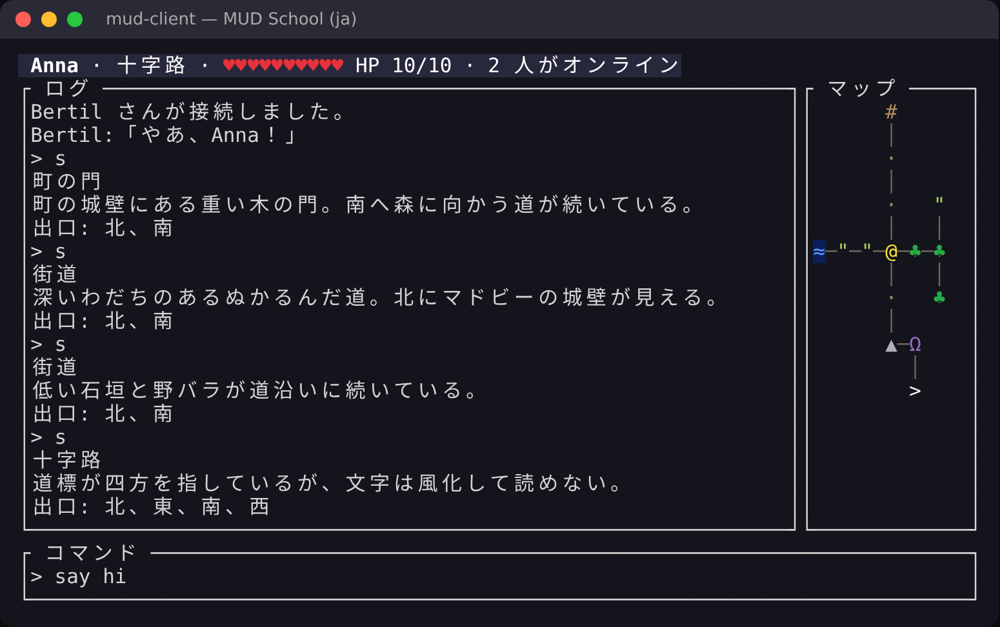
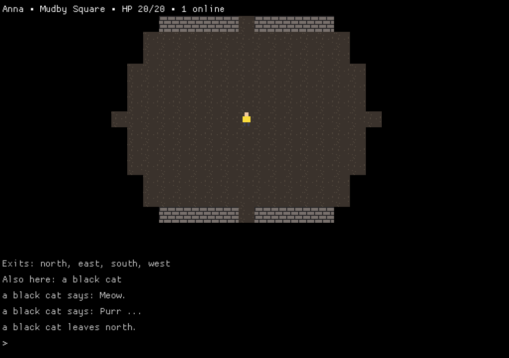
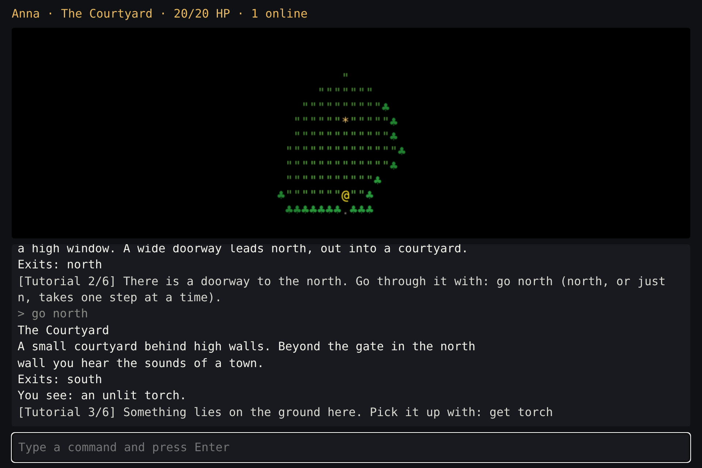

# MUD School 🐉

> [🇬🇧 English](README.md) · [🇸🇪 Svenska](README.sv.md) · 🇯🇵 日本語

**自分だけのオンラインゲームをゼロから作りながら、Go と Rust を学ぼう。**

**Go で MUD サーバー** を、**Rust で MUD クライアント** を一歩ずつ作ります。
始まりは 20 行のエコーサーバー。レッスン 13 を終えるころには、21 部屋とチャットと
JSON プロトコルを備えたマルチプレイヤーの世界と、Dwarf Fortress 風のカラーマップ・
ステータスバー・ログを持つ端末クライアントができあがっています:



（レッスン 13 を終えた模範解答の本物のスクリーンショットです。telnet でも遊べ、その場合マップはただの ASCII になります。）

フェーズ 3（レッスン 14〜22）で世界に命が宿ります。ゲームループ、アイテム、歩き回る
生き物、戦闘、そして SQLite に保存されるプレイヤー。フェーズ 4（レッスン 23〜30）では、
部屋がそれぞれ *Caves of Qud* 風のタイルのゾーンになり（シードから生成され、視界と狩りをする
生き物付き）、独自のタイルセット、光、マウスを備えたグラフィッククライアントが加わります:



フェーズ 5（レッスン 31〜36）では、サーバーを **稼働したまま** 拡張できるようにします。世界の
再読み込み、Lua スクリプト、Rust で書いて WebAssembly にコンパイルしたプラグイン、イベントと
フック、MUD の古典的な技法 *copyover*、そしてゲームの中からの世界の建築です。フェーズ 6
（レッスン 37〜44）はそれを外の世界へ連れ出します。新しいプレイヤーへのチュートリアル、
プレイヤーごとの言語、Web クライアント（WebAssembly にコンパイルしたあなたの Rust のコードが
ブラウザで動く）、VPS の上の Docker と Caddy、洪水への守り、そして非同期 Rust で千体の
ボットを走らせる負荷テスト:



コースは **英語・スウェーデン語・日本語** で提供しています。説明、ヒント、テストの
失敗メッセージ、ゲーム内のテキスト、ゲームの世界まで。

## はじめかた

**1. ツールをインストールする。** 必要なのは Go 1.22 以降、Rust（stable）、UTF-8 と
色を扱える端末です。telnet は不要です（`./mudschool connect` が内蔵されています）。
Windows・macOS・Linux 向けの手順は **[docs/ja/SETUP.md](docs/ja/SETUP.md)** にあります。

いちばん手軽なのは、リポジトリを **GitHub Codespaces** か **VS Code の Dev Container**
で開くことです。すべてインストール済みです（`.devcontainer/`）。

**2. 確認して始める。**

```
git clone https://github.com/mattias/mud-school.git && cd mud-school
./mudschool doctor             # 必要なものがそろっているか確認
./mudschool init --lang ja     # 自分のコードを置く workspace/ を作る（en | sv | ja）
./mudschool show               # 最初のレッスンを読む
./mudschool watch              # 保存するたびにテストが走る
```

**Windows**（PowerShell または cmd）では、コースに `./mudschool` とある所で
`.\mudschool.cmd` と入力します:

```powershell
git clone https://github.com/mattias/mud-school.git; cd mud-school
.\mudschool.cmd doctor
.\mudschool.cmd init --lang ja
.\mudschool.cmd show
```

マップに適したフォント（Windows Terminal など）は
[SETUP.md → フォントと端末](docs/ja/SETUP.md#フォントと端末) にあります。

## コースツール

| コマンド | 内容 |
|---|---|
| `./mudschool doctor` | Go、Rust、gcc、UTF-8、色を確認する |
| `./mudschool list` | レッスン一覧と進捗 |
| `./mudschool show [id]` | レッスンの説明 |
| `./mudschool check [--race]` | レッスンのテストを実行。合格すれば次へ進む |
| `./mudschool watch` | `check` と同じだが、保存時に自動で |
| `./mudschool hint` | 次のヒント（1 つずつ） |
| `./mudschool run server` / `run client` / `run gfx` | 自分のサーバー、クライアント、グラフィカルクライアントを起動 |
| `./mudschool run web` / `run loadtest` | Web クライアントをビルドしてサーバーを起動（レッスン 41）／負荷テストを実行（レッスン 44） |
| `./mudschool connect` | telnet のように、自分のサーバーへ手で接続する |
| `./mudschool solution [--apply]` | 模範解答を表示（またはコピー） |
| `./mudschool goto <id>` | レッスンへ移動 |
| `./mudschool update` | `git pull` の後、コースの修正を作業領域に取り込む（あなたのコードには触れない） |
| `./mudschool lang en\|sv\|ja` | 言語を切り替える |

あなたのコードはすべて `workspace/` にあります。`server/`（Go）と `client/`（Rust）です。
そこで直接 `go test ./...` や `cargo test` を実行することもできます。

### コースが更新されたら

```
git pull
./mudschool update
```

`update` が置き換えるのは、あなたが変更していないファイルだけです。あなたもコースも
変更したファイルは、コースの版が `<ファイル>.new` として隣に置かれます
（`messages.go`/`messages.rs` の場合は、あなたの版が `.bak` として保存されます）。
削除や改名をしたファイルはそのままです。`check` は安全な更新を自動で行い、`doctor` は待っている更新を知らせます。
`init` をやり直す必要はありません。

## レッスン

| # | | レッスン | 学ぶこと |
|---|---|---|---|
| 01 | Go | こんにちは、TCP！ | パッケージ、構造体、メソッド、`error`、`defer`、`net` |
| 02 | Go | 大勢で同時に遊ぶ | ゴルーチン、レース検出器 |
| 03 | Rust | こんにちは、Rust！ – 最初のクライアント | Cargo、`Result`/`?`、`Option`、所有権と借用 |
| 04 | Go | コマンド | マップ、スライス、値としての関数、テーブル駆動テスト |
| 05 | Go | プレイヤー | 自作のエラー、UTF-8 とルーン、`sync.Mutex` |
| 06 | Rust | スレッドとチャネル | `thread`、`mpsc`、ジェネリクス、`Send`/`'static` |
| 07 | Go | チャット | チャネル、`select`、遅いクライアント対策 |
| 08 | Go | 部屋 | ポインタ、クロージャ、グラフとしての世界 |
| 09 | Go | 世界ファイル | JSON、検証、`errors.Join`、`go:embed` |
| 10 | Go | プロトコルとマップ | インターフェース、同じゲームの 2 つのエンコード、`sync/atomic` |
| 11 | Rust | Rust でプロトコル | データ付き enum、`match`、serde、`Display` |
| 12 | Rust | カラーのマップ | イテレータ、`Copy`、ANSI トゥルーカラー |
| 13 | Rust | 本格的な画面 | ratatui、イベントループ、UI のテスト |
| 14 | Go | ゲームループ | アクターパターン、`time.Ticker`、`context` |
| 15 | Go | アイテム | ジェネリクス、制約としてのインターフェース |
| 16 | Go | 生き物 | `Behavior` インターフェース、シード付きの乱数 |
| 17 | Rust | 豊かなログ | serde の enum、履歴、スクロール |
| 18 | Go | 戦闘 | 乱数を注入したダイス、時計を自分で進めるテスト |
| 19 | Rust | クライアントでの戦闘 | `Instant`、注入した時計、`Gauge` |
| 20 | Go | 保存 | `database/sql`、SQLite、トランザクション、マイグレーション、bcrypt |
| 21 | Rust | 設定とログイン | `clap`、`toml`、`thiserror` |
| 22 | Go | 本気のテスト | ファジング、プロパティベーステスト |
| 23 | Go | ゾーン | 2D グリッド、状態の差分、`zone`/`delta` フレーム |
| 24 | Go | 手続き生成 | セル・オートマトン、ノイズ、塗りつぶし、シード |
| 25 | Rust | カメラ | serde の `rename`、`BTreeMap`、`saturating_sub` |
| 26 | Go | 視界 | 再帰的シャドウキャスティング、戦場の霧 |
| 27 | Go | 経路探索 | 汎用 A*、`container/heap`、ダイクストラマップ |
| 28 | Rust | グラフィカルクライアント | `Renderer` トレイト、Cargo の feature、macroquad |
| 29 | Rust | 光と命 | 色の混合、時間の関数としてのアニメーション、パーティクル |
| 30 | Rust | マウス | `BinaryHeap` + `Reverse`、座標系 |
| 31 | Go | 世界の再読み込み | ポーリング、検証してから入れ替え、管理者コマンド |
| 32 | Go | Lua のスクリプト | 組み込み言語、サンドボックス、`context` による制限時間 |
| 33 | Go + Rust | WebAssembly のプラグイン | wazero、ABI、`wasm32` にコンパイルした Rust |
| 34 | Go | イベントとフック | イベントバス、取り消せる行動 |
| 35 | Go | copyover | ファイルディスクリプター、`ExtraFiles`、接続の引き渡し |
| 36 | Go | ゲーム内での建築 | 適用・検証・取り消し、不可分な書き込み |
| 37 | Go | チュートリアル | データとしての振る舞い、フック、マイグレーション |
| 38 | Go | プレイヤーごとの言語 | `json.Unmarshaler`、`text/template` |
| 39 | Go | WebSocket | `net/http`、チャネルでできたリスナー、`go:embed` |
| 40 | Rust | コア | ワークスペース、`pub use`、孤児ルール |
| 41 | Rust | ブラウザのクライアント | WebAssembly、`cdylib`、ブラウザとの ABI |
| 42 | Go | インターネットへ | `log/slog`、`/healthz`、SIGTERM、Docker、Caddy |
| 43 | Go | 守り | トークンバケット、期限、`expvar`、`pprof` |
| 44 | Rust | 負荷テスト | tokio、`tokio::select!`、パーセンタイル |

旅の全体はフェーズごとに **[docs/ja/CURRICULUM.md](docs/ja/CURRICULUM.md)** で説明しています。

## ドキュメント

| | 🇬🇧 | 🇸🇪 | 🇯🇵 |
|---|---|---|---|
| 環境構築 | [SETUP](docs/en/SETUP.md) | [SETUP](docs/sv/SETUP.md) | [SETUP](docs/ja/SETUP.md) |
| カリキュラム: 教育の考え方、全フェーズ、Go ↔ Rust | [CURRICULUM](docs/en/CURRICULUM.md) | [CURRICULUM](docs/sv/CURRICULUM.md) | [CURRICULUM](docs/ja/CURRICULUM.md) |
| サーバーとクライアントのプロトコル | [PROTOCOL](docs/en/PROTOCOL.md) | [PROTOCOL](docs/sv/PROTOCOL.md) | [PROTOCOL](docs/ja/PROTOCOL.md) |
| ゲーム・クライアント・コースのアイデア | [IDEAS](docs/en/IDEAS.md) | [IDEAS](docs/sv/IDEAS.md) | [IDEAS](docs/ja/IDEAS.md) |
| 講師向け: コースの構成 | [TEACHERS](docs/en/TEACHERS.md) | [TEACHERS](docs/sv/TEACHERS.md) | [TEACHERS](docs/ja/TEACHERS.md) |

## 講師の方へ

`./mudschool verify` は 3 つの言語すべてで模範解答をレッスンごとに積み上げ、各レッスンの
テストが解答の **前には失敗し**、**後には合格する** ことを確認します。
`./mudschool reference <dir> [id]` で指定したレッスンまでの模範解答全体が手に入ります。
CI はプッシュのたびに `verify` を実行します。
