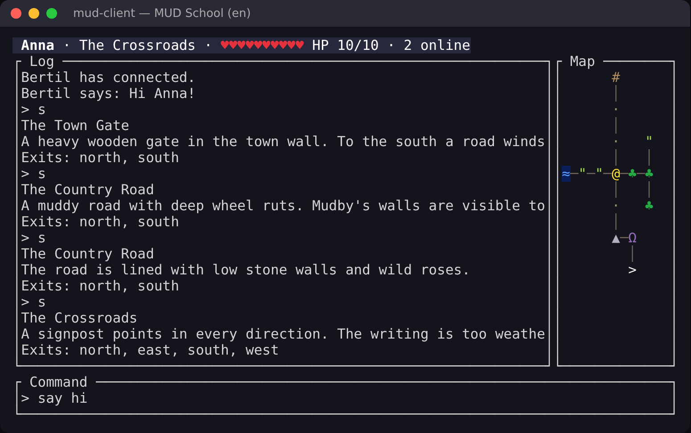

# MUD School 🐉

> 🇬🇧 English · [🇸🇪 Svenska](README.sv.md) · [🇯🇵 日本語](README.ja.md)

**Learn Go and Rust by building your own online game – from scratch.**

You build a **MUD server in Go** and a **MUD client in Rust**, step by step.
It all starts with a 20-line echo server. After lesson 13 you have a
multiplayer world with 21 rooms, chat and a JSON protocol – and a terminal
client with a Dwarf Fortress-style colour map, a status bar and a log:



(A real screenshot of the reference solution after lesson 13. Telnet works too; then the map is plain ASCII.)

Phase 3 (lessons 14–22) brings the world to life: a game loop, items,
creatures that wander, combat, and players who are saved in SQLite. Then the
curriculum continues: zones with tiles and procedural generation à la Caves of Qud, a graphical client with a tileset,
and a server that can be extended **while it is running** – with live world
reloading, Lua scripts, plugins written in Rust and compiled to WebAssembly,
and the classic MUD technique *copyover*.

The course is available in **English, Swedish and Japanese** – instructions,
hints, the tests' failure messages, the game's texts and the game world.

## Getting started

**1. Install the tools.** You need Go 1.22+, Rust (stable) and a terminal with
UTF-8 and colour (no telnet needed – `./mudschool connect` is built in). Step by step for Windows,
macOS and Linux: **[docs/en/SETUP.md](docs/en/SETUP.md)**.

Fastest: open the repository in **GitHub Codespaces** or a **VS Code Dev
Container** – everything is preinstalled (`.devcontainer/`).

**2. Check and start.**

```
git clone https://github.com/mattias/mud-school.git && cd mud-school
./mudschool doctor             # checks that everything is installed
./mudschool init --lang en     # creates workspace/ with your own code (en | sv | ja)
./mudschool show               # read the first lesson
./mudschool watch              # the tests run every time you save
```

On **Windows** (PowerShell or cmd) type `.\mudschool.cmd` wherever the
course says `./mudschool`:

```powershell
git clone https://github.com/mattias/mud-school.git; cd mud-school
.\mudschool.cmd doctor
.\mudschool.cmd init --lang en
.\mudschool.cmd show
```

Recommended fonts for the map (e.g. in Windows Terminal) are listed in
[SETUP.md → Fonts and terminals](docs/en/SETUP.md#fonts-and-terminals).

## The course tool

| Command | What it does |
|---|---|
| `./mudschool doctor` | checks Go, Rust, gcc, UTF-8 and colour |
| `./mudschool list` | every lesson and your progress |
| `./mudschool show [id]` | the instructions for a lesson |
| `./mudschool check [--race]` | runs the lesson's tests; when green you move on |
| `./mudschool watch` | like `check`, but automatically when you save |
| `./mudschool hint` | the next hint (one at a time) |
| `./mudschool run server` / `run client` | start your server or client |
| `./mudschool connect` | connect to your server by hand, like telnet |
| `./mudschool solution [--apply]` | show (or copy in) the reference solution |
| `./mudschool goto <id>` | jump to a lesson |
| `./mudschool update` | bring course fixes into your workspace after `git pull` (your own code is never touched) |
| `./mudschool lang en\|sv\|ja` | switch language |

All your code lives in `workspace/` – `server/` (Go) and `client/` (Rust).
You can also run `go test ./...` and `cargo test` directly there.

### When the course is updated

```
git pull
./mudschool update
```

`update` replaces only files you haven't changed. If you have changed a file
that the course has also changed, the course's version is put next to it as
`<file>.new` (for `messages.go`/`messages.rs` your version is kept as `.bak`).
Files you deleted or renamed stay that way. `check` applies the safe updates
automatically, and `doctor` tells you when something is waiting. You never need to run `init` again.

## The lessons

| # | | Lesson | You learn |
|---|---|---|---|
| 01 | Go | Hello, TCP! | packages, structs, methods, `error`, `defer`, `net` |
| 02 | Go | Many players at once | goroutines, the race detector |
| 03 | Rust | Hello, Rust! – a first client | Cargo, `Result`/`?`, `Option`, ownership and borrowing |
| 04 | Go | Commands | maps, slices, functions as values, table-driven tests |
| 05 | Go | Players | your own errors, UTF-8 and runes, `sync.Mutex` |
| 06 | Rust | Threads and channels | `thread`, `mpsc`, generics, `Send`/`'static` |
| 07 | Go | Chat | channels, `select`, protection against slow clients |
| 08 | Go | Rooms | pointers, closures, a world as a graph |
| 09 | Go | World files | JSON, validation, `errors.Join`, `go:embed` |
| 10 | Go | Protocol and map | interfaces, two encodings of the same game, `sync/atomic` |
| 11 | Rust | The protocol in Rust | enums with data, `match`, serde, `Display` |
| 12 | Rust | The map in colour | iterators, `Copy`, ANSI truecolor |
| 13 | Rust | A real user interface | ratatui, an event loop, testing a UI |
| 14 | Go | The game loop | the actor pattern, `time.Ticker`, `context` |
| 15 | Go | Items | generics, interfaces as constraints |
| 16 | Go | Creatures | a `Behavior` interface, seeded randomness |
| 17 | Rust | A richer log | serde enums, history, scrolling |
| 18 | Go | Combat | dice with injected randomness, tests that step the clock themselves |
| 19 | Rust | Combat in the client | `Instant`, an injected clock, `Gauge` |
| 20 | Go | Saving | `database/sql`, SQLite, transactions, migrations, bcrypt |
| 21 | Rust | Settings and login | `clap`, `toml`, `thiserror` |
| 22 | Go | Testing for real | fuzzing, property-based tests |

Phases 4–6 (lessons 23–36 and optional tracks) are described in **[docs/en/CURRICULUM.md](docs/en/CURRICULUM.md)**.

## Documentation

| | 🇬🇧 | 🇸🇪 | 🇯🇵 |
|---|---|---|---|
| Setup and environment | [SETUP](docs/en/SETUP.md) | [SETUP](docs/sv/SETUP.md) | [SETUP](docs/ja/SETUP.md) |
| Curriculum: teaching, every phase, Go ↔ Rust | [CURRICULUM](docs/en/CURRICULUM.md) | [CURRICULUM](docs/sv/CURRICULUM.md) | [CURRICULUM](docs/ja/CURRICULUM.md) |
| The protocol between server and client | [PROTOCOL](docs/en/PROTOCOL.md) | [PROTOCOL](docs/sv/PROTOCOL.md) | [PROTOCOL](docs/ja/PROTOCOL.md) |
| Ideas for the game, the client and the course | [IDEAS](docs/en/IDEAS.md) | [IDEAS](docs/sv/IDEAS.md) | [IDEAS](docs/ja/IDEAS.md) |
| For teachers: how the course is built | [TEACHERS](docs/en/TEACHERS.md) | [TEACHERS](docs/sv/TEACHERS.md) | [TEACHERS](docs/ja/TEACHERS.md) |

## For teachers

`./mudschool verify` builds up the reference solution lesson by lesson, in all
three languages, and checks that every lesson's tests **fail before** and
**pass after** the solution. `./mudschool reference <dir> [id]` gives you the
whole reference solution up to a given lesson. CI runs `verify` on every push.
