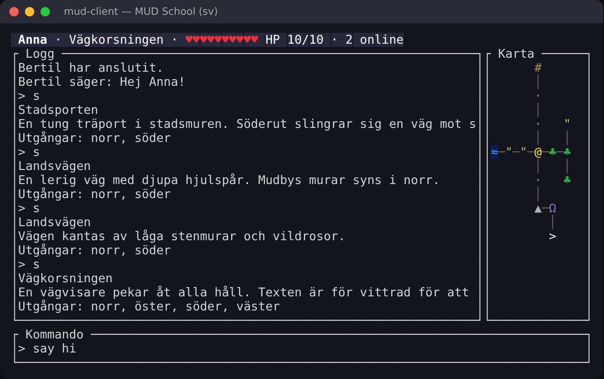
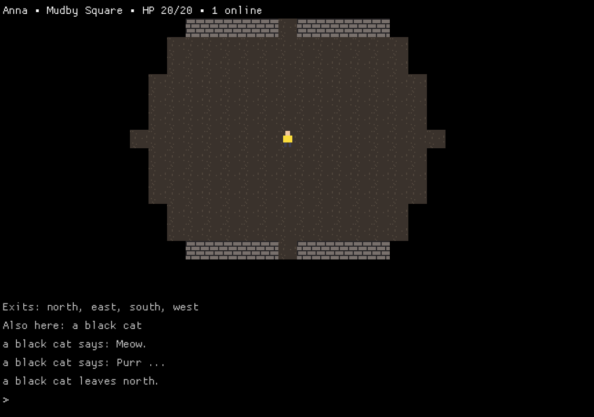

# MUD School 🐉

> [🇬🇧 English](README.md) · 🇸🇪 Svenska · [🇯🇵 日本語](README.ja.md)

**Lär dig Go och Rust genom att bygga ett eget onlinespel – från grunden.**

Du bygger en **MUD-server i Go** och en **MUD-klient i Rust**, steg för steg.
Allt börjar med en ekoserver på 20 rader. Efter lektion 13 har du en
flerspelarvärld med 21 rum, chatt och ett JSON-protokoll – och en
terminalklient med färgkarta i Dwarf Fortress-stil, statusrad och logg:



(En riktig skärmbild av referenslösningen efter lektion 13. Telnet fungerar också, då blir kartan ren ASCII.)

Fas 3 (lektion 14–22) väcker världen till liv: en spelloop, föremål, varelser
som vandrar, strid och spelare som sparas i SQLite. Fas 4 (lektion 23–30) gör
varje rum till en zon av rutor à la *Caves of Qud* – genererad från ett frö,
med synfält och jagande varelser – och lägger till en grafisk klient med eget
tileset, ljus och mus:



Fas 5 (lektion 31–36) gör servern utbyggbar **medan den kör**: omladdning av
världen, Lua-skript, plugins skrivna i Rust och kompilerade till WebAssembly,
händelser och hooks, den klassiska MUD-tekniken *copyover*, och att bygga
världen inifrån spelet.

Kursen finns på **engelska, svenska och japanska** – instruktioner, ledtrådar,
testernas felmeddelanden, spelets texter och spelvärlden.

## Kom igång

**1. Installera verktygen.** Du behöver Go 1.22+, Rust (stable) och en
terminal med UTF-8 och färg (ingen telnet behövs – `./mudschool connect` finns
inbyggt). Steg för steg
för Windows, macOS och Linux finns i **[docs/sv/SETUP.md](docs/sv/SETUP.md)**.

Snabbast: öppna repot i **GitHub Codespaces** eller en **VS Code Dev
Container** – allt är förinstallerat (`.devcontainer/`).

**2. Kontrollera och börja.**

```
git clone https://github.com/mattias/mud-school.git && cd mud-school
./mudschool doctor             # kontrollerar att allt är installerat
./mudschool init --lang sv     # skapar workspace/ med din egen kod (en | sv | ja)
./mudschool show               # läs första lektionen
./mudschool watch              # testerna körs varje gång du sparar
```

På **Windows** (PowerShell eller cmd) skriver du `.\mudschool.cmd` överallt
där kursen skriver `./mudschool`:

```powershell
git clone https://github.com/mattias/mud-school.git; cd mud-school
.\mudschool.cmd doctor
.\mudschool.cmd init --lang sv
.\mudschool.cmd show
```

Rekommenderade typsnitt för kartan (t.ex. i Windows Terminal) finns i
[SETUP.md → Typsnitt och terminaler](docs/sv/SETUP.md#typsnitt-och-terminaler).

## Kursverktyget

| Kommando | Vad det gör |
|---|---|
| `./mudschool doctor` | kontrollerar Go, Rust, gcc, UTF-8 och färg |
| `./mudschool list` | alla lektioner och din status |
| `./mudschool show [id]` | instruktionerna för en lektion |
| `./mudschool check [--race]` | kör lektionens tester; vid grönt går du vidare |
| `./mudschool watch` | som `check`, men automatiskt när du sparar |
| `./mudschool hint` | nästa ledtråd (en i taget) |
| `./mudschool run server` / `run client` / `run gfx` | starta din server, klient eller grafiska klient |
| `./mudschool connect` | anslut till din server för hand, som telnet |
| `./mudschool solution [--apply]` | visa (eller kopiera in) referenslösningen |
| `./mudschool goto <id>` | hoppa till en lektion |
| `./mudschool update` | hämta kursens rättelser till din arbetsyta efter `git pull` (din egen kod rörs aldrig) |
| `./mudschool lang en\|sv\|ja` | byt språk |

All din kod ligger i `workspace/` – `server/` (Go) och `client/` (Rust).
Du kan också köra `go test ./...` och `cargo test` direkt där.

### När kursen uppdateras

```
git pull
./mudschool update
```

`update` byter bara ut filer du inte har ändrat. Har du ändrat en fil som
kursen också har ändrat läggs kursens version bredvid som `<fil>.new` (för
`messages.go`/`messages.rs` sparas din version som `.bak`). Filer du tagit bort eller döpt om får vara ifred. `check` gör de
säkra uppdateringarna automatiskt, och `doctor` säger till när något väntar.
Du behöver aldrig köra `init` igen.

## Lektionerna

| # | | Lektion | Du lär dig |
|---|---|---|---|
| 01 | Go | Hej, TCP! | paket, structs, metoder, `error`, `defer`, `net` |
| 02 | Go | Många spelare samtidigt | goroutines, race detectorn |
| 03 | Rust | Hej, Rust! – en första klient | Cargo, `Result`/`?`, `Option`, ägarskap och lån |
| 04 | Go | Kommandon | maps, slices, funktioner som värden, tabelldrivna tester |
| 05 | Go | Spelare | egna fel, UTF-8 och runor, `sync.Mutex` |
| 06 | Rust | Trådar och kanaler | `thread`, `mpsc`, generics, `Send`/`'static` |
| 07 | Go | Chatt | kanaler, `select`, skydd mot långsamma klienter |
| 08 | Go | Rum | pekare, closures, en värld som graf |
| 09 | Go | Världsfiler | JSON, validering, `errors.Join`, `go:embed` |
| 10 | Go | Protokoll och karta | gränssnitt, två kodningar av samma spel, `sync/atomic` |
| 11 | Rust | Protokoll i Rust | enums med data, `match`, serde, `Display` |
| 12 | Rust | Kartan i färg | iteratorer, `Copy`, ANSI truecolor |
| 13 | Rust | Ett riktigt gränssnitt | ratatui, händelseloop, testa UI |
| 14 | Go | Spelloopen | actor-mönstret, `time.Ticker`, `context` |
| 15 | Go | Föremål | generics, gränssnitt som villkor |
| 16 | Go | Varelser | ett `Behavior`-gränssnitt, slump med fast seed |
| 17 | Rust | Rikare logg | serde-enums, historik, scrollning |
| 18 | Go | Strid | tärningar med injicerad slump, tester som stegar klockan själva |
| 19 | Rust | Strid i klienten | `Instant`, injicerad klocka, `Gauge` |
| 20 | Go | Spara | `database/sql`, SQLite, transaktioner, migreringar, bcrypt |
| 21 | Rust | Inställningar och inloggning | `clap`, `toml`, `thiserror` |
| 22 | Go | Testa på riktigt | fuzzing, egenskapsbaserade tester |
| 23 | Go | Zoner | 2D-rutnät, skillnader i tillstånd, `zone`/`delta`-frames |
| 24 | Go | Procedurgenerering | cellautomater, brus, flood fill, frön |
| 25 | Rust | Kameran | serde `rename`, `BTreeMap`, `saturating_sub` |
| 26 | Go | Synfält | rekursiv skuggkastning, krigets dimma |
| 27 | Go | Vägval | generisk A*, `container/heap`, Dijkstra-kartor |
| 28 | Rust | En grafisk klient | en `Renderer`-trait, Cargo-features, macroquad |
| 29 | Rust | Ljus och liv | färgblandning, animation som funktioner av tiden, partiklar |
| 30 | Rust | Musen | `BinaryHeap` + `Reverse`, koordinatsystem |
| 31 | Go | Ladda om världen | pollning, validera-sedan-byt, adminkommandon |
| 32 | Go | Skript i Lua | ett inbäddat språk, en sandlåda, tidsgränser med `context` |
| 33 | Go + Rust | Plugins i WebAssembly | wazero, ett ABI, Rust kompilerat till `wasm32` |
| 34 | Go | Händelser och hooks | en händelsebuss, handlingar som kan avbrytas |
| 35 | Go | Copyover | fildeskriptorer, `ExtraFiles`, överlämning av anslutningar |
| 36 | Go | Bygga i spelet | genomför–validera–ångra, atomiska skrivningar |

Fas 6 (valfria spår) och hela resan beskrivs i **[docs/sv/CURRICULUM.md](docs/sv/CURRICULUM.md)**.

## Dokumentation

| | 🇬🇧 | 🇸🇪 | 🇯🇵 |
|---|---|---|---|
| Installation och miljö | [SETUP](docs/en/SETUP.md) | [SETUP](docs/sv/SETUP.md) | [SETUP](docs/ja/SETUP.md) |
| Kursplan: pedagogik, alla faser, Go ↔ Rust | [CURRICULUM](docs/en/CURRICULUM.md) | [CURRICULUM](docs/sv/CURRICULUM.md) | [CURRICULUM](docs/ja/CURRICULUM.md) |
| Protokollet mellan server och klient | [PROTOCOL](docs/en/PROTOCOL.md) | [PROTOCOL](docs/sv/PROTOCOL.md) | [PROTOCOL](docs/ja/PROTOCOL.md) |
| Idéer för spelet, klienten och kursen | [IDEAS](docs/en/IDEAS.md) | [IDEAS](docs/sv/IDEAS.md) | [IDEAS](docs/ja/IDEAS.md) |
| För lärare: hur kursen är byggd | [TEACHERS](docs/en/TEACHERS.md) | [TEACHERS](docs/sv/TEACHERS.md) | [TEACHERS](docs/ja/TEACHERS.md) |

## För lärare

`./mudschool verify` bygger upp referenslösningen lektion för lektion, på alla
tre språken, och kontrollerar att varje lektions tester **misslyckas före** och
**går igenom efter** lösningen. `./mudschool reference <katalog> [id]` ger dig
hela referenslösningen till och med en viss lektion. CI kör `verify` vid varje push.
