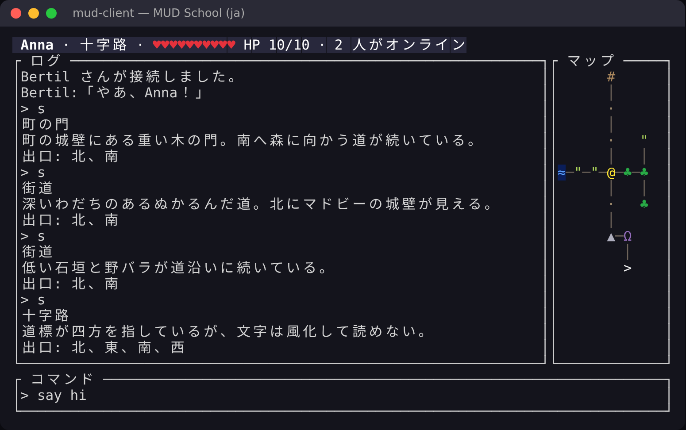

# レッスン 13 – 本格的な画面

「行を表示して祈る」段階は卒業です。ゲームらしく見えるクライアントを作りましょう。
上にステータスバー、左にログ、右にマップ、下に入力欄。すべてを 1 秒に何度も
描き直します。



## 目標

- **ratatui** を使う: レイアウト、ウィジェット、即時モードの描画。
- `From` を実装して型を変換する（`rgb.into()`）。
- キーボードとサーバーを `enum Event` で **1 つ** のイベントループにまとめる。
- `TestBackend` を使い、端末なしでユーザーインターフェースをテストする。

## 構成

```
 keyboard thread ──Event::Key──────┐
                                   ├──► channel ──► main loop: update App ──► draw App
 server thread ────Event::Server───┘
```

（キーボードのスレッドとサーバーのスレッドが同じチャネルにイベントを送り、メインループが
`App` を更新して描画します。）

これは *The Elm Architecture* と呼ばれることがあります。ロジックはすべて `App` にあり、
イベントで変更され、純粋な関数 `draw(frame, &app)` で描画されます。そのため、
クライアントのほぼ全体をネットワークも端末もなしにテストできます。
`mudschool_13.rs` を見てください。

**Go ↔ Rust:** 送信側が複数あるチャネル（`tx.clone()`）は、Go で複数のゴルーチンが
同じ `chan` に送るのとまったく同じです。

## Rust の概念

### 即時モードの描画

ratatui は状態から **毎回画面全体を** 描きます。フレームをまたいで「生き続ける」
ウィジェットはなく、`draw` の中で毎回作り直します。ratatui は前のフレームと比べ、
変わった部分だけを端末に送ります。

```rust
let [top, middle, bottom] = Layout::vertical([
    Constraint::Length(1),   // ちょうど 1 行
    Constraint::Min(3),      // 残り
    Constraint::Length(3),
]).areas(frame.area());

frame.render_widget(Paragraph::new("hi").block(Block::bordered().title(" ログ ")), middle);
```

テキストは `Span` からなる `Line` で組み立て、各 `Span` は `Style` を持ちます:

```rust
Line::from(vec![
    Span::styled("♣", Style::default().fg(Color::Rgb(40, 170, 70))),
    Span::raw(" 森"),
])
```

### From と Into

```rust
impl From<Rgb> for Color {
    fn from(Rgb(r, g, b): Rgb) -> Color { Color::Rgb(r, g, b) }
}
let c: Color = rgb.into();   // Into はおまけで付いてくる！
```

### std::mem::take

`std::mem::take(&mut self.input)` は値を取り出し、代わりに空の `String` を残します。
`&mut` から値を *移動して取り出したい* ときのよくある技です。

## 課題

1. `cargo add ratatui`（`crossterm` も一緒に入り、`ratatui::crossterm` として使えます）。
2. **`src/app.rs`**（新しいファイル）: `From<Rgb> for Color`、`push_log`、`on_server`、
   `on_key`、`draw_status`、`draw_log`、`draw_map` を埋める。見出しなどのテキストは
   `messages.rs` にあります（`messages::TITLE_LOG` など）。`lib.rs` に `pub mod app;` を追加する。
3. **`src/main.rs`**: クライアントを書き直す:
   - `enum Event { Key(KeyEvent), Server(ServerMsg), Disconnected }`、
   - サーバーを読んで `Event::Server`（最後に `Event::Disconnected`）を送るスレッドと、
     `ratatui::crossterm::event::read()` でキーボードを読んで `Event::Key` を送るスレッド、
   - `let mut terminal = ratatui::init();` の後、ループ: 描画し、イベントを待ち、
     `App` を更新し、`on_key` が行を返したらサーバーに送る、
   - 最後に `ratatui::restore();` を呼ぶ。何かが失敗した場合 **でも** です。でないと
     端末が「raw モード」のまま残ります（そうなったら `reset` と入力してください）。

## 自分で試す

```
./mudschool run server
./mudschool run client
```

もう 1 つクライアント（または telnet）を開いて、自分と話してみましょう。歩き回り、
マップとステータスバーが更新されるのを見てください。

## 考えてみよう

- キーボードをメインループではなく専用のスレッドで読むのはなぜ？
- `draw` は `&mut App` ではなく `&App` を取ります。なぜそれがよい考えなのでしょう？
- サーバーが一度に 1000 行送ってきたらどうなる？（解答の `rx.try_iter()` を見てみて）

## チャレンジ

- ログに色を付ける: 発言はある色、`その方向には進めません。` は別の色。サーバーが
  テキストの *種類* を送るべきかも？（まさにフェーズ 3 で行うプロトコル拡張です。）
- 履歴: 上下の矢印キーで以前のコマンドをたどる。
- PageUp/PageDown でログをスクロールする。
- F1 でヘルプウィンドウ（`Clear` + `Paragraph` を全体の上に重ねる）を表示する。
