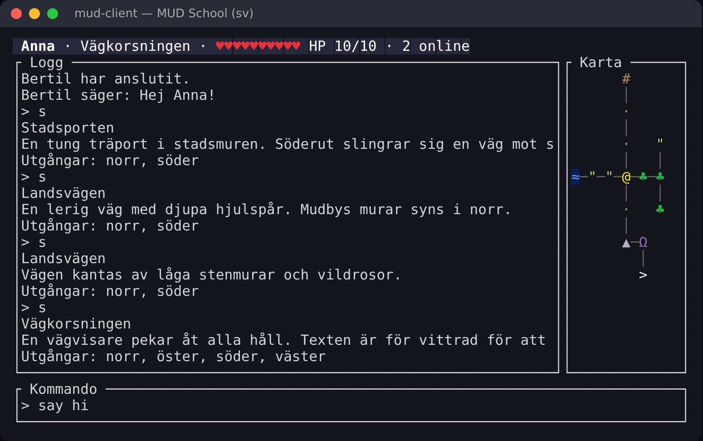

# Lektion 13 – Ett riktigt gränssnitt

Dags att lämna "skriv ut rader och hoppas"-stadiet. Nu bygger vi en klient
som ser ut som ett spel: en statusrad överst, loggen till vänster, kartan
till höger och en inmatningsrad längst ner – allt ritat om flera gånger i
sekunden.



## Mål

- Använda **ratatui**: layouter, widgets och omedelbar rendering.
- Implementera `From` för att konvertera mellan typer (`rgb.into()`).
- Samla tangentbord och server i **en** händelseloop med en `enum Event`.
- Testa ett användargränssnitt utan terminal med `TestBackend`.

## Arkitektur

```
 tangentbordstråd ──Event::Key──────┐
                                    ├──► kanal ──► huvudloop: uppdatera App ──► rita App
 serverstråd ──────Event::Server────┘
```

Det här kallas ibland *The Elm Architecture*: all logik bor i `App`,
som ändras av händelser och ritas av en ren funktion `draw(frame, &app)`.
Det gör att nästan hela klienten kan testas utan nätverk och utan terminal –
titta i `mudschool_13.rs`.

**Go ↔ Rust:** kanalen med flera sändare (`tx.clone()`) är precis som när
flera goroutines skickar till samma `chan` i Go.

## Rust-koncept

### Omedelbar rendering

ratatui ritar **hela skärmen varje gång** från ditt tillstånd. Det finns
inga widgets som "lever" mellan bildrutorna – du bygger dem på nytt i `draw`.
ratatui jämför sedan med förra bildrutan och skickar bara ändringarna till
terminalen.

```rust
let [top, middle, bottom] = Layout::vertical([
    Constraint::Length(1),   // exakt en rad
    Constraint::Min(3),      // resten
    Constraint::Length(3),
]).areas(frame.area());

frame.render_widget(Paragraph::new("hej").block(Block::bordered().title(" Logg ")), middle);
```

Text byggs av `Line`s som består av `Span`s, och varje `Span` har en `Style`:

```rust
Line::from(vec![
    Span::styled("♣", Style::default().fg(Color::Rgb(40, 170, 70))),
    Span::raw(" skog"),
])
```

### From och Into

```rust
impl From<Rgb> for Color {
    fn from(Rgb(r, g, b): Rgb) -> Color { Color::Rgb(r, g, b) }
}
let c: Color = rgb.into();   // Into får du på köpet!
```

### std::mem::take

`std::mem::take(&mut self.input)` tar ut värdet och lämnar en tom `String`
kvar – ett vanligt knep när man vill *flytta ut* något ur en `&mut`.

## Uppgift

1. `cargo add ratatui` (den tar med sig `crossterm`, som du når som
   `ratatui::crossterm`).
2. **`src/app.rs`** (ny fil): fyll i `From<Rgb> for Color`, `push_log`,
   `on_server`, `on_key`, `draw_status`, `draw_log` och `draw_map`.
   Rubriker och andra texter finns i `messages.rs` (`messages::TITLE_LOG`, ...).
   Lägg till `pub mod app;` i `lib.rs`.
3. **`src/main.rs`**: skriv om klienten:
   - en `enum Event { Key(KeyEvent), Server(ServerMsg), Disconnected }`,
   - en tråd som läser servern och skickar `Event::Server` (och till sist
     `Event::Disconnected`), och en tråd som läser tangentbordet med
     `ratatui::crossterm::event::read()` och skickar `Event::Key`,
   - `let mut terminal = ratatui::init();`, sedan en loop: rita, vänta på en
     händelse, uppdatera `App`, skicka raden till servern om `on_key` gav en,
   - avsluta med `ratatui::restore();` – **även** om något gick fel, annars
     lämnas terminalen i "raw mode" (skriv `reset` om det händer).

## Testa själv

```
./mudschool run server
./mudschool run client
```

Öppna en till klient (eller telnet) och prata med dig själv. Gå runt och se
kartan och statusraden uppdateras.

## Fundera på

- Varför läser vi tangentbordet i en egen tråd istället för i huvudloopen?
- `draw` tar `&App`, inte `&mut App`. Varför är det en bra idé?
- Vad händer om servern skickar 1000 rader på en gång? (Titta på
  `rx.try_iter()` i lösningen.)

## Utmaningar

- Färglägg loggen: `Anna säger:` i en färg, `Du kan inte gå åt det hållet.`
  i en annan. Kanske ska servern skicka *vilken sorts* text det är?
  (Det är exakt en sådan protokollutökning vi gör i fas 3.)
- Historik: pil upp/ner bläddrar bland tidigare kommandon.
- Scrolla loggen med PageUp/PageDown.
- Fäll ut ett hjälpfönster (`Clear` + `Paragraph` ovanpå allt annat) med F1.
